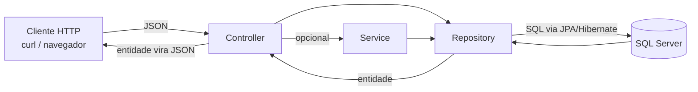

# Arquitetura MVC e camadas no Spring Boot

Guia rápido para quem está começando. O foco é entender **por que o código fica dividido em pacotes** e o que cada pacote faz. Todos os projetos de exemplo seguem exatamente a mesma estrutura, então aprender uma vez vale para os 100.

## 1. O que é MVC e como o Spring Boot REST adapta

**MVC** significa *Model–View–Controller*. A ideia é separar o código em três papéis:

- **Model**: quais são os dados?
- **View**: como mostrar ao usuário? (numa aplicação web clássica, páginas HTML)
- **Controller**: quem recebe o pedido e decide o que fazer?

Em uma API REST não existe página HTML. O Spring Boot adapta o modelo assim (o Controller não escreve SQL e o Repository não sabe o que é HTTP):

- **Model** → as entidades (`Cliente`, `Pedido`), que também representam as tabelas do banco.
- **Controller** → as classes `@RestController`, que expõem os endpoints HTTP.
- **View** → o próprio **JSON** devolvido na resposta. O Spring converte o objeto Java em JSON automaticamente.

Além desses três papéis, o Spring Boot costuma ter a camada de **Repository** (acesso ao banco) e, opcionalmente, a de **Service** (regras de negócio). Por isso falamos em "arquitetura em camadas".

Fluxo de uma requisição:



## 2. Por que separar em pacotes

Separar em pacotes deixa claro **onde cada coisa mora**. Quando você precisa mudar uma consulta, vai direto em `repository`. Quando precisa mudar uma rota, vai em `controller`. Nada de uma classe gigante com tudo misturado.

Estrutura real de cada projeto:

```
NN-slug/
  pom.xml
  run.ps1 / run.bat
  src/main/resources/application.properties
  src/main/java/com/exemplo/<slug>/
    Application.java
    model/Cliente.java, model/Pedido.java
    repository/ClienteRepository.java
    service/ClienteService.java        (só em alguns projetos)
    controller/ClienteController.java
```

`pom.xml` define as dependências (Maven), `run.ps1`/`run.bat` sobem a aplicação e `application.properties` configura banco e JPA (seção 8).

O Spring procura componentes (`@RestController`, `@Service` etc.) **a partir do pacote da classe `Application`** e dos pacotes abaixo dele. Por isso `model`, `repository`, `service` e `controller` ficam dentro de `com.exemplo.<slug>`. Colocar uma classe fora dessa árvore faz o Spring ignorá-la.

| Pacote | Responsabilidade | Anotação típica |
|---|---|---|
| (raiz) `Application` | Iniciar a aplicação | `@SpringBootApplication` |
| `model` | Representar os dados e as tabelas | `@Entity`, `@Table`, `@Id` |
| `repository` | Ler e gravar no banco | (interface que estende `JpaRepository`) |
| `service` | Regras de negócio (opcional) | `@Service` |
| `controller` | Receber HTTP e devolver JSON | `@RestController`, `@RequestMapping` |

## 3. Model: as entidades

Uma **entidade** é uma classe Java mapeada para uma tabela. Cada objeto é uma linha; cada atributo é uma coluna.

`model/Cliente.java`:

```java
package com.exemplo.slug.model;

import jakarta.persistence.*;

@Entity
@Table(name = "clientes")
public class Cliente {

    @Id
    @GeneratedValue(strategy = GenerationType.IDENTITY)
    private Long id;

    @Column(nullable = false, length = 100)
    private String nome;

    @Column(length = 150)
    private String email;

    public Cliente() {
    }

    public Long getId() { return id; }
    public void setId(Long id) { this.id = id; }

    public String getNome() { return nome; }
    public void setNome(String nome) { this.nome = nome; }

    public String getEmail() { return email; }
    public void setEmail(String email) { this.email = email; }
}
```

`model/Pedido.java`:

```java
package com.exemplo.slug.model;

import jakarta.persistence.*;

import java.math.BigDecimal;

@Entity
@Table(name = "pedidos")
public class Pedido {

    @Id
    @GeneratedValue(strategy = GenerationType.IDENTITY)
    private Long id;

    @Column(length = 200)
    private String descricao;

    @Column(precision = 10, scale = 2)
    private BigDecimal valor;

    @ManyToOne
    @JoinColumn(name = "cliente_id")
    private Cliente cliente;

    public Pedido() {
    }

    public Long getId() { return id; }
    public void setId(Long id) { this.id = id; }

    public String getDescricao() { return descricao; }
    public void setDescricao(String descricao) { this.descricao = descricao; }

    public BigDecimal getValor() { return valor; }
    public void setValor(BigDecimal valor) { this.valor = valor; }

    public Cliente getCliente() { return cliente; }
    public void setCliente(Cliente cliente) { this.cliente = cliente; }
}
```

### Anotação por anotação

| Anotação | O que faz |
|---|---|
| `@Entity` | Diz ao JPA que a classe é uma entidade persistente. Exige construtor sem argumentos e um `@Id`. |
| `@Table(name = "clientes")` | Define o nome da tabela. Sem ela, o nome seria derivado do da classe. |
| `@Id` | Marca o atributo que é a chave primária. |
| `@GeneratedValue(strategy = GenerationType.IDENTITY)` | O banco gera o valor. No SQL Server vira uma coluna `IDENTITY` (autoincremento). |
| `@Column` | Ajusta a coluna: `nullable`, `length`, `precision`, `scale`, `name`. É opcional; sem ela valem os padrões. |
| `@ManyToOne` | Muitos pedidos pertencem a **um** cliente. O atributo guarda a referência ao objeto `Cliente`. |
| `@JoinColumn(name = "cliente_id")` | Nome da coluna de chave estrangeira na tabela `pedidos`. |

Pontos de atenção:

- Os imports são `jakarta.persistence.*`. No Spring Boot 3 o pacote antigo `javax.persistence` **não funciona mais**.
- O `@ManyToOne` é carregado junto com o pedido por padrão (`FetchType.EAGER`), então o JSON do pedido já traz o cliente aninhado.
- Como não há DTOs, **o JSON é a própria entidade**. Os nomes dos atributos viram os nomes dos campos JSON.

### Tabelas geradas

Com `spring.jpa.hibernate.ddl-auto=update`, o Hibernate cria as tabelas na primeira execução. O SQL gerado é parecido com este (os nomes das constraints variam):

```sql
CREATE TABLE clientes (
    id    BIGINT IDENTITY NOT NULL PRIMARY KEY,
    nome  VARCHAR(100) NOT NULL,
    email VARCHAR(150)
);

CREATE TABLE pedidos (
    id         BIGINT IDENTITY NOT NULL PRIMARY KEY,
    descricao  VARCHAR(200),
    valor      NUMERIC(10,2),
    cliente_id BIGINT
);

ALTER TABLE pedidos ADD FOREIGN KEY (cliente_id) REFERENCES clientes (id);
```

Repare que a coluna `cliente_id` vem do `@JoinColumn`, e a chave estrangeira aponta para `clientes(id)`.

## 4. Repository: acesso ao banco

O repository é uma **interface**. Você não escreve a implementação: o Spring Data JPA gera uma em tempo de execução.

`repository/PedidoRepository.java`:

```java
package com.exemplo.slug.repository;

import com.exemplo.slug.model.Pedido;
import org.springframework.data.jpa.repository.JpaRepository;

import java.util.List;

public interface PedidoRepository extends JpaRepository<Pedido, Long> {

    List<Pedido> findByClienteId(Long id);
}
```

`JpaRepository<Pedido, Long>` recebe dois tipos: a **entidade** (`Pedido`) e o **tipo do `@Id`** (`Long`).

O `ClienteRepository` é igual, trocando os tipos e usando `List<Cliente> findByNomeContaining(String nome);`.

### Métodos herdados

| Método | O que faz | Retorno |
|---|---|---|
| `findAll()` | Busca todos os registros | `List<T>` |
| `findById(id)` | Busca por chave primária | `Optional<T>` (vazio se não existir) |
| `save(entidade)` | `INSERT` se o `id` for `null`; `UPDATE` se o `id` existir | a entidade salva |
| `deleteById(id)` | Apaga pelo `id` | `void` |
| `existsById(id)` | Confere se existe, sem carregar o objeto | `boolean` |

### Consultas por nome de método

O Spring Data lê o **nome do método** e monta o SQL. Basta seguir o padrão `findBy` + atributo + operador:

| Método | Equivale a |
|---|---|
| `findByClienteId(Long id)` | `WHERE cliente_id = ?` (navega em `pedido.cliente.id`) |
| `findByNomeContaining(String nome)` | `WHERE nome LIKE %?%` |

Se o nome do atributo estiver errado, a aplicação **falha ao subir**, o que ajuda a achar o erro cedo.

## 5. Controller: os endpoints

O controller recebe a requisição HTTP, chama o repository (ou o service) e devolve a resposta.

`controller/PedidoController.java`:

```java
package com.exemplo.slug.controller;

import com.exemplo.slug.model.Pedido;
import com.exemplo.slug.repository.PedidoRepository;
import org.springframework.http.HttpStatus;
import org.springframework.http.ResponseEntity;
import org.springframework.web.bind.annotation.*;

import java.util.List;

@RestController
@RequestMapping("/pedidos")
public class PedidoController {

    private final PedidoRepository repository;

    public PedidoController(PedidoRepository repository) {
        this.repository = repository;
    }

    @GetMapping
    public List<Pedido> listar() {
        return repository.findAll();
    }

    @GetMapping("/{id}")
    public ResponseEntity<Pedido> buscar(@PathVariable Long id) {
        return repository.findById(id)
                .map(ResponseEntity::ok)
                .orElse(ResponseEntity.notFound().build());
    }

    @PostMapping
    public ResponseEntity<Pedido> criar(@RequestBody Pedido pedido) {
        pedido.setId(null);
        Pedido salvo = repository.save(pedido);
        return ResponseEntity.status(HttpStatus.CREATED).body(salvo);
    }

    @PutMapping("/{id}")
    public ResponseEntity<Pedido> atualizar(@PathVariable Long id, @RequestBody Pedido pedido) {
        if (!repository.existsById(id)) {
            return ResponseEntity.notFound().build();
        }
        pedido.setId(id);
        return ResponseEntity.ok(repository.save(pedido));
    }

    @DeleteMapping("/{id}")
    public ResponseEntity<Void> excluir(@PathVariable Long id) {
        if (!repository.existsById(id)) {
            return ResponseEntity.notFound().build();
        }
        repository.deleteById(id);
        return ResponseEntity.noContent().build();
    }
}
```

O que cada parte faz:

- `@RestController`: marca a classe como controller e faz o retorno virar **JSON** (é `@Controller` + `@ResponseBody`).
- `@RequestMapping("/pedidos")`: prefixo de rota de todos os métodos da classe.
- `@GetMapping`, `@PostMapping`, `@PutMapping`, `@DeleteMapping`: ligam o verbo HTTP ao método.
- `@PathVariable`: pega o valor de `{id}` na URL.
- `@RequestBody`: converte o JSON do corpo da requisição em um objeto Java.
- `ResponseEntity<T>`: permite controlar o **status HTTP** além do corpo.
- `setId(null)` no POST evita que um `id` enviado no corpo atualize um registro existente; `setId(id)` no PUT garante que o `id` da URL manda.

### Verbo HTTP → método → status

| Verbo e rota | Método | Sucesso | Quando falha |
|---|---|---|---|
| `GET /pedidos` | `listar()` | `200 OK` (lista, pode ser vazia) | — |
| `GET /pedidos/{id}` | `buscar()` | `200 OK` | `404 Not Found` |
| `POST /pedidos` | `criar()` | `201 Created` | — |
| `PUT /pedidos/{id}` | `atualizar()` | `200 OK` | `404 Not Found` |
| `DELETE /pedidos/{id}` | `excluir()` | `204 No Content` | `404 Not Found` |

## 6. Service (opcional)

O service fica **entre** o controller e o repository e concentra regras de negócio. Em alguns projetos ele existe; em outros o controller chama o repository direto.

Vale a pena criar um service quando:

- há regra de negócio (por exemplo, "não permitir e-mail repetido");
- a mesma lógica é usada por mais de um controller;
- uma operação mexe em várias entidades e precisa de transação (`@Transactional`).

Para um CRUD puro, o service só repassa chamadas e pode ser dispensado.

`service/ClienteService.java`:

```java
package com.exemplo.slug.service;

import com.exemplo.slug.model.Cliente;
import com.exemplo.slug.repository.ClienteRepository;
import org.springframework.stereotype.Service;

import java.util.List;

@Service
public class ClienteService {

    private final ClienteRepository repository;

    public ClienteService(ClienteRepository repository) {
        this.repository = repository;
    }

    public List<Cliente> listar() {
        return repository.findAll();
    }

    public Cliente criar(Cliente cliente) {
        cliente.setId(null);
        return repository.save(cliente);
    }

    public boolean excluir(Long id) {
        if (!repository.existsById(id)) {
            return false;
        }
        repository.deleteById(id);
        return true;
    }
}
```

O controller então recebe o `ClienteService` no construtor, em vez do repository, e delega:

```java
@PostMapping
public ResponseEntity<Cliente> criar(@RequestBody Cliente cliente) {
    return ResponseEntity.status(HttpStatus.CREATED).body(service.criar(cliente));
}

@DeleteMapping("/{id}")
public ResponseEntity<Void> excluir(@PathVariable Long id) {
    return service.excluir(id)
            ? ResponseEntity.noContent().build()
            : ResponseEntity.notFound().build();
}
```

(Trecho resumido: `buscar` e `atualizar` seguem o mesmo padrão.)

### Injeção de dependência

O controller precisa de um service; o service precisa de um repository. Em vez de você escrever `new ClienteService(...)`, o **Spring cria os objetos e entrega prontos**. Isso é a *injeção de dependência*: a classe declara o que precisa, e o container do Spring fornece.

Existem duas formas comuns:

```java
// 1) Injeção por campo: funciona, mas não é recomendada
@Autowired
private ClienteRepository repository;

// 2) Injeção por construtor: a forma recomendada
private final ClienteRepository repository;

public ClienteService(ClienteRepository repository) {
    this.repository = repository;
}
```

| | `@Autowired` no campo | Construtor |
|---|---|---|
| Campo `final` (imutável) | Não | Sim |
| Dá para criar o objeto em um teste sem o Spring | Difícil | Fácil (`new ClienteService(repoFalso)`) |
| Precisa de `@Autowired` | Sim | Não, se houver um único construtor |

Os exemplos deste guia usam construtor. O guia [04](04-requisicoes-respostas-e-injecao.md) detalha o container, os beans, `@Value`, `@Bean` e os erros de injeção.

## 7. Fluxo de uma requisição passo a passo

Exemplo: criar um pedido para o cliente de `id` 1.

```
POST http://localhost:8080/pedidos
Content-Type: application/json

{
  "descricao": "Notebook",
  "valor": 3500.00,
  "cliente": { "id": 1 }
}
```

1. **HTTP chega ao Tomcat.** Nos projetos deste repositório, o `run.ps1` implanta o `ROOT.war` em um Tomcat externo (porta 8080 por padrão). O `DispatcherServlet` olha o verbo (`POST`) e a rota (`/pedidos`) e escolhe o método `PedidoController.criar`.
2. **Controller: desserialização.** Por causa do `@RequestBody`, o Jackson converte o JSON em um objeto `Pedido`. O campo `cliente` vira um `Cliente` com **apenas o `id` preenchido** (`nome` e `email` ficam `null`).
3. **Controller: preparação.** `pedido.setId(null)` garante que será um `INSERT`. Se houvesse um service, a regra de negócio rodaria neste ponto.
4. **Repository: `save(pedido)`.** Como o `id` é `null`, o Spring Data decide que a entidade é nova e chama `persist`.
5. **Hibernate gera o SQL.** O atributo `cliente` vira o valor da coluna `cliente_id`. O comando executado é parecido com:

   ```sql
   INSERT INTO pedidos (cliente_id, descricao, valor) VALUES (?, ?, ?)
   ```

   Com `spring.jpa.show-sql=true`, você vê esse SQL no console.
6. **SQL Server executa o `INSERT`.** A coluna `IDENTITY` gera o novo `id`, e o Hibernate o lê de volta e coloca no objeto.
7. **Volta ao controller.** `save` devolve o `Pedido` com o `id` preenchido. O controller monta `ResponseEntity.status(HttpStatus.CREATED).body(salvo)`.
8. **Serialização.** O Jackson transforma o objeto em JSON (a "View") e o Spring responde `201 Created`:

   ```json
   {
     "id": 1,
     "descricao": "Notebook",
     "valor": 3500.00,
     "cliente": { "id": 1, "nome": null, "email": null }
   }
   ```

Note que o `cliente` na resposta do POST só traz o `id`, porque o objeto devolvido é o mesmo que foi recebido. Um `GET /pedidos/1` em seguida carrega o cliente completo do banco.

Se o `id` do cliente **não existir**, o SQL Server rejeita o `INSERT` por violar a chave estrangeira e a API responde `500`. Os projetos não tratam esse erro (são didáticos); veja os próximos passos.

## 8. application.properties

Fica em `src/main/resources/application.properties`. Os projetos desta coleção vêm com os valores que o `setup-sqlserver.ps1` cria (banco `projeto`, login `projeto`, senha `Projeto@123`):

```properties
spring.datasource.url=jdbc:sqlserver://localhost:1433;databaseName=projeto;encrypt=true;trustServerCertificate=true
spring.datasource.username=projeto
spring.datasource.password=Projeto@123
spring.jpa.hibernate.ddl-auto=update
spring.jpa.show-sql=true
```

| Propriedade | O que significa |
|---|---|
| `spring.datasource.url` | Endereço JDBC do banco. Veja o detalhamento abaixo. |
| `spring.datasource.username` | Login do SQL Server (autenticação SQL, não Windows). |
| `spring.datasource.password` | Senha do login. Se rodou o setup com outros parâmetros, ajuste aqui; não publique senhas reais. |
| `spring.jpa.hibernate.ddl-auto=update` | O Hibernate cria tabelas e colunas que faltam ao subir. Não apaga nada. |
| `spring.jpa.show-sql=true` | Imprime no console cada SQL executado. Ótimo para aprender. |

Partes da URL:

- `jdbc:sqlserver://localhost:1433`: driver, servidor e porta padrão do SQL Server.
- `databaseName=projeto`: o banco usado. Ele precisa **existir** (o `setup-sqlserver.ps1` o cria); o Hibernate cria só as tabelas.
- `encrypt=true`: a conexão usa criptografia (padrão do driver atual da Microsoft).
- `trustServerCertificate=true`: aceita o certificado autoassinado do servidor local. Sem isso, a conexão costuma falhar com erro de certificado em ambiente de desenvolvimento. Em produção, use um certificado válido.

Outros valores de `ddl-auto`: `none` (não mexe), `validate` (só confere), `create` (recria tudo e perde dados) e `create-drop`. `update` é cômodo para estudo; em produção, prefira migrações (Flyway ou Liquibase).

O guia [05](05-configuracao-properties-sqlserver-tomcat.md) aprofunda o arquivo: propriedades de log, variáveis de ambiente, perfis, configuração do SQL Server e do Tomcat.

## 9. Como testar os endpoints

Com a aplicação rodando (por exemplo, via `run.ps1` ou `run.bat`), a API responde em `http://localhost:8080`.

### Com curl

Crie primeiro um cliente (precisa existir antes do pedido):

```bash
# POST: criar (201)
curl -i -X POST http://localhost:8080/clientes \
  -H "Content-Type: application/json" \
  -d '{"nome":"Ana Souza","email":"ana@exemplo.com"}'

# GET: listar (200)
curl -i http://localhost:8080/clientes

# GET: buscar por id (200 ou 404)
curl -i http://localhost:8080/clientes/1

# PUT: atualizar (200 ou 404)
curl -i -X PUT http://localhost:8080/clientes/1 \
  -H "Content-Type: application/json" \
  -d '{"nome":"Ana Souza Lima","email":"ana.lima@exemplo.com"}'

# DELETE: excluir (204 ou 404)
curl -i -X DELETE http://localhost:8080/clientes/1
```

Pedido com a relação aninhada (o cliente de `id` 1 precisa existir):

```bash
curl -i -X POST http://localhost:8080/pedidos \
  -H "Content-Type: application/json" \
  -d '{"descricao":"Notebook","valor":3500.00,"cliente":{"id":1}}'
```

A opção `-i` mostra status e cabeçalhos, útil para conferir `201`, `204` e `404`.

Observações:

- No **PowerShell**, use `curl.exe` (o `curl` puro é um alias de `Invoke-WebRequest`) e escape as aspas do JSON, por exemplo `-d "{\"nome\":\"Ana\"}"`. No Git Bash e no Linux, os exemplos acima funcionam como estão.
- Sem o cabeçalho `Content-Type: application/json`, o Spring responde `415`; JSON mal formado resulta em `400`.

### Com o navegador

O navegador só faz `GET` ao digitar uma URL. Abra:

- `http://localhost:8080/clientes` → lista de clientes em JSON
- `http://localhost:8080/clientes/1` → um cliente
- `http://localhost:8080/pedidos` → lista de pedidos, com o cliente aninhado

Para `POST`, `PUT` e `DELETE`, use `curl` ou uma ferramenta como Postman ou Insomnia.

## 10. Próximos passos

Os projetos são didáticos e deixam de fora alguns pontos que uma API real precisa:

- **DTOs**: classes próprias para entrada e saída, em vez de expor a entidade. Evitam vazar campos internos e permitem que o POST receba só `clienteId`, em vez de `{ "cliente": { "id": 1 } }`.
- **Validação com `@Valid`**: anotações como `@NotBlank`, `@Email` e `@Positive` nos campos, com `@Valid` no `@RequestBody`. Requer a dependência `spring-boot-starter-validation`.
- **Tratamento de erros com `@ControllerAdvice`**: uma classe central que converte exceções em respostas JSON claras (por exemplo, `400` para dados inválidos e `409` para violação de chave estrangeira), em vez de `500` genérico. Exemplo testado no guia [04](04-requisicoes-respostas-e-injecao.md), seção 2.
- **Paginação**: usar `Pageable` e `Page<T>` (`findAll(Pageable)`) para não devolver milhares de registros de uma vez, com parâmetros como `?page=0&size=20`.
