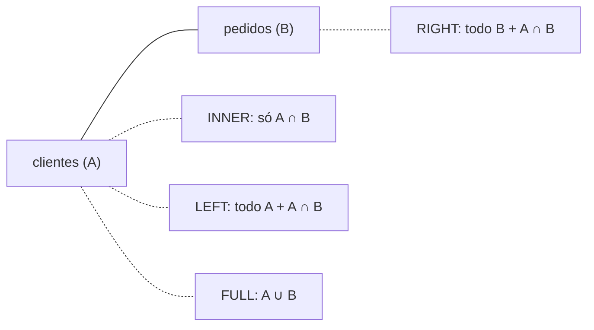

# SQL Server (T-SQL): guia rápido

Este guia é para quem roda os projetinhos CRUD com **Java + Spring Boot + JPA** e quer olhar, consertar ou popular os dados direto no banco. Tudo aqui assume:

- Instância: `localhost\SQLEXPRESS` (porta TCP 1433).
- Banco: `projeto`.
- Login: `sa` ou o login SQL criado pelo script de setup.
- Tabelas criadas pelo Hibernate (`ddl-auto=update`), em `snake_case` plural: `clientes`, `pedidos`, com `id BIGINT IDENTITY` e chave estrangeira `cliente_id`.

Os exemplos usam `clientes` e `pedidos`. Se o seu projeto tem outras entidades, troque os nomes.

## 1. Como conectar

### sqlcmd com autenticação Windows

```bash
sqlcmd -S localhost\SQLEXPRESS -d projeto -E
```

`-S` é servidor\instância, `-d` é o banco e `-E` usa o seu usuário do Windows (sem senha). Essa forma depende do serviço **SQL Server Browser**. Se falhar, use a forma com porta.

### sqlcmd com login SQL

```bash
sqlcmd -S localhost,1433 -d projeto -U projeto -P Projeto@123 -C
```

O login `projeto` (senha `Projeto@123`) é criado pelo `setup-sqlserver.ps1`; `sa` também funciona se você souber a senha dele.

- A vírgula separa servidor e porta.
- `-C` confia no certificado do servidor (equivale a `trustServerCertificate=true` no JDBC). Sem ele, versões novas do `sqlcmd` reclamam do certificado autoassinado.
- `-P senha` fica no histórico do terminal. Serve para estudo local; se omitir o `-P`, a senha é pedida na hora.

### O que é o `GO`

No `sqlcmd`, nada é executado até você digitar `GO` sozinho em uma linha. O `GO` não é T-SQL: é o separador de lotes (batches) do `sqlcmd` e do SSMS.

```sql
1> SELECT COUNT(*) FROM clientes;
2> GO
```

- `GO 5` repete o lote 5 vezes.
- Para sair, digite `EXIT`.
- Variáveis (`DECLARE @x INT`) só existem dentro do lote: depois de um `GO` elas somem.

### SSMS (SQL Server Management Studio)

1. Em **Server name**, informe `localhost\SQLEXPRESS` (ou `localhost,1433`).
2. Escolha **Windows Authentication** ou **SQL Server Authentication** (`sa` + senha). Se der erro de certificado, marque **Trust server certificate**.
3. Clique em **New Query**, selecione o banco `projeto` na barra superior e execute com `F5` (sem precisar de `GO`).

### VS Code: extensão "SQL Server (mssql)"

1. Instale a extensão **SQL Server (mssql)** da Microsoft e use `Ctrl+Shift+P` → **MS SQL: Add Connection**.
2. Informe o servidor (`localhost,1433`), o banco `projeto`, o tipo de login e marque **Trust server certificate**.
3. Abra um arquivo `.sql`, escolha a conexão em **MS SQL: Connect** e execute com `Ctrl+Shift+E`.

## 2. Comandos rápidos de exploração

```sql
-- Bancos da instância
SELECT name FROM sys.databases;

-- Trocar para o banco do projeto (se não passou -d projeto)
USE projeto;

-- Tabelas
SELECT TABLE_SCHEMA, TABLE_NAME
FROM INFORMATION_SCHEMA.TABLES
WHERE TABLE_TYPE = 'BASE TABLE'
ORDER BY TABLE_NAME;

-- Colunas de uma tabela
SELECT COLUMN_NAME, DATA_TYPE, CHARACTER_MAXIMUM_LENGTH, IS_NULLABLE
FROM INFORMATION_SCHEMA.COLUMNS
WHERE TABLE_NAME = 'clientes'
ORDER BY ORDINAL_POSITION;

-- Alternativa curta: colunas, IDENTITY, chaves e índices
EXEC sp_help 'clientes';

-- Chaves estrangeiras
SELECT
    fk.name                                              AS chave_estrangeira,
    OBJECT_NAME(fk.parent_object_id)                     AS tabela,
    COL_NAME(fkc.parent_object_id, fkc.parent_column_id) AS coluna,
    OBJECT_NAME(fk.referenced_object_id)                 AS tabela_referenciada
FROM sys.foreign_keys fk
INNER JOIN sys.foreign_key_columns fkc
    ON fkc.constraint_object_id = fk.object_id;

-- Contar linhas
SELECT COUNT(*) AS total FROM clientes;
```

## 3. Tipos de dados e o mapeamento Java → SQL Server

Quando o Hibernate cria a tabela, ele escolhe o tipo SQL a partir do tipo Java do atributo:

| Tipo Java | Tipo SQL Server | Observação |
|---|---|---|
| `String` | `varchar(255)` | O tamanho muda com `@Column(length = ...)`. |
| `String` com `@Nationalized` | `nvarchar(255)` | Unicode completo (acentos fora do Latin-1, emojis). |
| `Integer` / `int` | `int` | 32 bits. |
| `Long` / `long` | `bigint` | Tipo padrão do `id`. |
| `Double` / `double` | `float` | Ponto flutuante: impreciso para dinheiro. |
| `BigDecimal` | `numeric(38,2)` | Use para valores monetários. Ajuste com `precision` e `scale`. |
| `Boolean` / `boolean` | `bit` | `0` ou `1`. |
| `LocalDate` | `date` | Só a data. |
| `LocalDateTime` | `datetime2(6)` | Data e hora com 6 casas de fração de segundo. |
| `UUID` | `uniqueidentifier` | Alternativa ao `id` numérico. |
| `enum` (`EnumType.STRING`) | `varchar(255)` | Guarda o nome da constante. |

> [!TIP]
> Use `BigDecimal` para dinheiro. `Double` vira `float` no banco e acumula erro de arredondamento (`0.1 + 0.2` não dá exatamente `0.3`).

## 4. DDL básico

### Criar o banco

```sql
CREATE DATABASE projeto;

-- Só se ainda não existir
IF DB_ID('projeto') IS NULL
    CREATE DATABASE projeto;
```

### Criar tabelas

```sql
USE projeto;
GO

CREATE TABLE clientes (
    id        BIGINT IDENTITY(1,1) NOT NULL,
    nome      VARCHAR(255)         NOT NULL,
    email     VARCHAR(255)         NULL,
    ativo     BIT                  NOT NULL DEFAULT 1,
    criado_em DATETIME2(6)         NOT NULL DEFAULT SYSDATETIME(),
    CONSTRAINT pk_clientes PRIMARY KEY (id)
);

CREATE TABLE pedidos (
    id           BIGINT IDENTITY(1,1) NOT NULL,
    cliente_id   BIGINT               NOT NULL,
    data_pedido  DATE                 NOT NULL,
    valor_total  NUMERIC(38,2)        NOT NULL,
    status       VARCHAR(255)         NOT NULL,
    CONSTRAINT pk_pedidos PRIMARY KEY (id),
    CONSTRAINT fk_pedidos_cliente FOREIGN KEY (cliente_id)
        REFERENCES clientes (id)
);
```

- `IDENTITY(1,1)` gera o id sozinho: começa em 1 e soma 1 a cada linha. Não informe o `id` no `INSERT`.
- Crie `clientes` antes de `pedidos`: a FK precisa que a tabela referenciada já exista.

> [!NOTE]
> Com `ddl-auto=update`, deixe o Hibernate criar as tabelas. Criar a mesma tabela à mão com colunas diferentes causa conflitos. Use o `CREATE TABLE` acima para estudo em um banco separado.

### Alterar e apagar

```sql
ALTER TABLE clientes ADD telefone VARCHAR(20) NULL;
ALTER TABLE clientes DROP COLUMN telefone;

DROP TABLE pedidos;
```

- Se a coluna tem `DEFAULT` ou outra constraint, o `DROP COLUMN` falha até você remover a constraint.
- Apague primeiro a tabela filha (`pedidos`): se outra tabela aponta por FK para a que você quer apagar, o SQL Server recusa.

Versão que não falha se a tabela não existir (`'U'` = tabela de usuário):

```sql
IF OBJECT_ID('pedidos', 'U') IS NOT NULL
    DROP TABLE pedidos;

IF OBJECT_ID('clientes', 'U') IS NOT NULL
    DROP TABLE clientes;
```

## 5. INSERT, UPDATE e DELETE

### INSERT

```sql
-- Uma linha
INSERT INTO clientes (nome, email)
VALUES ('Ana Souza', 'ana@exemplo.com');

-- Várias linhas
INSERT INTO clientes (nome, email, ativo)
VALUES
    ('Bruno Lima',  'bruno@exemplo.com', 1),
    ('Carla Dias',  'carla@exemplo.com', 1),
    ('Diego Rocha', NULL,                0);

-- Devolvendo o id gerado (OUTPUT fica antes do VALUES)
INSERT INTO clientes (nome, email)
OUTPUT INSERTED.id
VALUES ('Eduarda Melo', 'eduarda@exemplo.com');

-- Pedidos (cliente_id precisa existir em clientes)
INSERT INTO pedidos (cliente_id, data_pedido, valor_total, status)
VALUES
    (1, '2026-10-01', 150.50, 'PAGO'),
    (1, '2026-10-05',  89.90, 'PENDENTE'),
    (2, '2026-10-07', 320.00, 'PAGO');
```

`OUTPUT INSERTED.id` também funciona com várias linhas (devolve um id por linha). Outra opção é `SELECT SCOPE_IDENTITY();` logo após o `INSERT`.

Para datas literais, use `'yyyy-MM-dd'`. Evite `'05/10/2026'`: a interpretação depende do idioma do login.

### UPDATE e DELETE

```sql
UPDATE clientes
SET email = 'ana.souza@exemplo.com',
    ativo = 1
WHERE id = 1;

DELETE FROM pedidos
WHERE status = 'CANCELADO';
```

> [!WARNING]
> **`UPDATE` ou `DELETE` sem `WHERE` afeta a tabela inteira.**
> `DELETE FROM clientes;` apaga todos os clientes e `UPDATE clientes SET ativo = 0;` desativa todos. Antes de rodar, escreva um `SELECT` com o mesmo `WHERE` e confira as linhas. Em dúvida, use uma transação (seção 9) para poder desfazer com `ROLLBACK`.

Para apagar um cliente que tem pedidos, apague os pedidos primeiro (por causa da FK):

```sql
DELETE FROM pedidos  WHERE cliente_id = 2;
DELETE FROM clientes WHERE id = 2;
```

## 6. SELECT

### Colunas, alias e WHERE

```sql
SELECT id AS codigo, nome AS cliente FROM clientes;

SELECT * FROM pedidos WHERE valor_total > 100 AND status = 'PAGO';
```

Operadores: `=`, `<>` (ou `!=`), `>`, `<`, `>=`, `<=`, `AND`, `OR`, `NOT`. Em código de verdade, liste as colunas em vez de usar `*`.

```sql
-- LIKE: % = qualquer sequência, _ = um caractere
SELECT * FROM clientes WHERE nome LIKE 'A%';

-- IN: um entre vários valores
SELECT * FROM pedidos WHERE status IN ('PAGO', 'PENDENTE');

-- BETWEEN: intervalo, inclui as duas pontas
SELECT * FROM pedidos WHERE data_pedido BETWEEN '2026-10-01' AND '2026-10-31';

-- IS NULL: nunca use = NULL
SELECT * FROM clientes WHERE email IS NULL;
```

### ORDER BY, TOP e paginação

```sql
SELECT * FROM pedidos ORDER BY valor_total DESC, id ASC;

-- Os 10 maiores pedidos
SELECT TOP 10 * FROM pedidos ORDER BY valor_total DESC;

-- Página 3 com 10 itens por página (ORDER BY é obrigatório)
SELECT id, nome
FROM clientes
ORDER BY id
OFFSET 20 ROWS FETCH NEXT 10 ROWS ONLY;
```

O `OFFSET` é `(página - 1) * tamanho`. É o que o Spring Data gera quando você usa `Pageable`.

### DISTINCT e funções de agregação

```sql
SELECT DISTINCT status FROM pedidos;

SELECT
    COUNT(*)         AS qtd_pedidos,
    SUM(valor_total) AS soma,
    AVG(valor_total) AS media,
    MIN(valor_total) AS menor,
    MAX(valor_total) AS maior
FROM pedidos;
```

`COUNT(*)` conta linhas; `COUNT(email)` conta só as que têm `email` preenchido.

### GROUP BY e HAVING

`WHERE` filtra linhas **antes** de agrupar; `HAVING` filtra os grupos **depois**:

```sql
SELECT cliente_id, COUNT(*) AS qtd, SUM(valor_total) AS total
FROM pedidos
WHERE status = 'PAGO'
GROUP BY cliente_id
HAVING SUM(valor_total) > 200
ORDER BY total DESC;
```

### CASE

```sql
SELECT
    id,
    valor_total,
    CASE
        WHEN valor_total >= 300 THEN 'Alto'
        WHEN valor_total >= 100 THEN 'Médio'
        ELSE 'Baixo'
    END AS faixa
FROM pedidos;
```

## 7. JOINs

Um `JOIN` combina linhas de duas tabelas usando uma condição (`ON`). Com `clientes` (A) à esquerda e `pedidos` (B) à direita:



Onde não há par, as colunas do outro lado vêm como `NULL`.

| JOIN | Resultado |
|---|---|
| `INNER JOIN` | Só as linhas que casam nos dois lados. |
| `LEFT JOIN` | Todas de `clientes` + as que casam em `pedidos`. |
| `RIGHT JOIN` | Todas de `pedidos` + as que casam em `clientes`. |
| `FULL JOIN` | Todas dos dois lados, casando quando possível. |

```sql
-- INNER: só clientes que têm pedidos
SELECT c.nome, p.id AS pedido, p.valor_total
FROM clientes c
INNER JOIN pedidos p ON p.cliente_id = c.id
ORDER BY c.nome;

-- LEFT: todos os clientes; filtrando p.id IS NULL, quem nunca comprou
SELECT c.nome
FROM clientes c
LEFT JOIN pedidos p ON p.cliente_id = c.id
WHERE p.id IS NULL;

-- RIGHT: todos os pedidos, mesmo sem cliente correspondente
SELECT c.nome, p.id AS pedido
FROM clientes c
RIGHT JOIN pedidos p ON p.cliente_id = c.id;

-- FULL: tudo dos dois lados (útil para achar inconsistências)
SELECT c.id AS cliente, p.id AS pedido
FROM clientes c
FULL JOIN pedidos p ON p.cliente_id = c.id;
```

Com a FK `cliente_id NOT NULL`, o `RIGHT` e o `FULL` não trazem nada além do `INNER`/`LEFT`. Na prática, quase todo mundo reescreve `RIGHT JOIN` como `LEFT JOIN` trocando a ordem das tabelas.

### Subconsulta

Pedidos com valor acima da média:

```sql
SELECT id, valor_total
FROM pedidos
WHERE valor_total > (SELECT AVG(valor_total) FROM pedidos);
```

### EXISTS

Clientes com pelo menos um pedido pago:

```sql
SELECT c.id, c.nome
FROM clientes c
WHERE EXISTS (
    SELECT 1
    FROM pedidos p
    WHERE p.cliente_id = c.id
      AND p.status = 'PAGO'
);
```

## 8. Datas e strings

### Datas

```sql
SELECT GETDATE();                                   -- data e hora atuais
SELECT DATEADD(DAY, 7, GETDATE());                  -- daqui a 7 dias
SELECT DATEADD(MONTH, -1, GETDATE());               -- 1 mês atrás
SELECT DATEDIFF(DAY, '2026-10-01', '2026-10-14');   -- 13 (fim - início)
SELECT FORMAT(GETDATE(), 'dd/MM/yyyy HH:mm');       -- 14/10/2026 16:46
SELECT CONVERT(VARCHAR(10), GETDATE(), 103);        -- 14/10/2026
```

- Partes aceitas em `DATEADD`/`DATEDIFF`: `YEAR`, `MONTH`, `DAY`, `HOUR`, `MINUTE`, `SECOND`.
- `FORMAT` é prático, mas lento em tabelas grandes. Para filtrar, compare a coluna direto em vez de formatá-la.

Pedidos dos últimos 30 dias:

```sql
SELECT * FROM pedidos
WHERE data_pedido >= DATEADD(DAY, -30, CAST(GETDATE() AS DATE));
```

### Strings

```sql
SELECT CONCAT(nome, ' <', email, '>') FROM clientes;   -- CONCAT trata NULL como vazio
SELECT nome + ' - ' + email FROM clientes;             -- com +, NULL anula o resultado
SELECT UPPER(nome), LOWER(nome) FROM clientes;
SELECT LEN('  texto  ');                               -- 7 (LEN ignora espaços finais)
SELECT SUBSTRING('Spring Boot', 1, 6);                 -- Spring (índice começa em 1)
SELECT TRIM('   olá   ');                              -- olá (SQL Server 2017+)
```

## 9. Transações

Uma transação agrupa comandos para que todos tenham efeito ou nenhum. É ótima para testar um `UPDATE`/`DELETE` perigoso:

```sql
BEGIN TRAN;

UPDATE pedidos
SET status = 'CANCELADO'
WHERE cliente_id = 1;

-- Confira o efeito antes de decidir
SELECT id, cliente_id, status FROM pedidos WHERE cliente_id = 1;

ROLLBACK;     -- desfaz tudo
-- COMMIT;    -- ou confirma de vez (use um dos dois)
```

- `BEGIN TRAN` abre, `COMMIT` confirma e `ROLLBACK` desfaz.
- Enquanto a transação está aberta, as linhas ficam **bloqueadas** para outras conexões, inclusive a aplicação Spring. Sempre feche com `COMMIT` ou `ROLLBACK`.
- `SELECT @@TRANCOUNT;` mostra quantas transações estão abertas na sessão.

## 10. Diferenças rápidas vs MySQL/PostgreSQL

| Assunto | SQL Server | MySQL | PostgreSQL |
|---|---|---|---|
| Limitar linhas | `TOP 10` ou `OFFSET/FETCH` | `LIMIT 10` | `LIMIT 10` |
| Id automático | `IDENTITY(1,1)` | `AUTO_INCREMENT` | `SERIAL` / `GENERATED ... AS IDENTITY` |
| Data e hora atual | `GETDATE()` | `NOW()` | `NOW()` |
| Concatenar texto | `+` ou `CONCAT()` | `CONCAT()` | `\|\|` ou `CONCAT()` |
| Texto Unicode | `nvarchar` (`varchar` não é Unicode) | `utf8mb4` na coluna | `varchar`/`text` já são Unicode |
| Booleano | `bit` (0/1) | `tinyint(1)` / `boolean` | `boolean` |
| Nome reservado | `[order]` | `` `order` `` | `"order"` |
| Id gerado no INSERT | `OUTPUT INSERTED.id` | `LAST_INSERT_ID()` | `RETURNING id` |
| Listar bancos | `SELECT name FROM sys.databases` | `SHOW DATABASES` | `\l` |
| Listar tabelas | `INFORMATION_SCHEMA.TABLES` | `SHOW TABLES` | `\dt` |

Pegadinhas comuns:

- **Colchetes**: nomes reservados (`user`, `order`, `group`) precisam de `[user]`. O Hibernate faz isso sozinho; à mão, é com você.
- **Prefixo `N`**: para literais Unicode, escreva `N'João'`. Sem o `N`, caracteres fora da codepage do banco viram `?`.
- **Aspas**: texto usa aspas simples (`'texto'`).
- **Maiúsculas e acentos**: por padrão, `=` e `LIKE` ignoram maiúsculas/minúsculas e acentos (collation `CI_AI`, comum em instalações em português e inglês).

## 11. Problemas comuns ao conectar com o Java

O passo a passo do `setup-sqlserver.ps1`, a anatomia da URL JDBC e o pool de conexões estão no guia [05](05-configuracao-properties-sqlserver-tomcat.md), seção 2.

URL JDBC que funciona neste ambiente (valores criados pelo `setup-sqlserver.ps1`; rodá-lo de novo resolve a maioria dos erros abaixo):

```properties
spring.datasource.url=jdbc:sqlserver://localhost:1433;databaseName=projeto;encrypt=true;trustServerCertificate=true
spring.datasource.username=projeto
spring.datasource.password=Projeto@123
spring.jpa.hibernate.ddl-auto=update
```

| Mensagem de erro | Causa provável | Solução |
|---|---|---|
| `The TCP/IP connection to the host localhost, port 1433 has failed` | Serviço parado, TCP/IP desativado, ou SQLEXPRESS em porta dinâmica (não 1433). Sem porta na URL, o **SQL Server Browser** também precisa estar rodando. | No **SQL Server Configuration Manager**: **Protocols for SQLEXPRESS** → ative **TCP/IP** → aba **IP Addresses** → em **IPAll**, deixe **TCP Dynamic Ports** vazio e **TCP Port** = `1433`. Reinicie o serviço **SQL Server (SQLEXPRESS)**. |
| `Login failed for user 'projeto'` (ou `'sa'`) | Modo misto desligado, login inexistente/desabilitado ou senha errada. | Rode o `setup-sqlserver.ps1` como Administrador (ele liga o modo misto e recria o login). Manualmente, no SSMS: servidor → **Properties → Security** → **SQL Server and Windows Authentication mode**, depois `ALTER LOGIN projeto ENABLE;` e `ALTER LOGIN projeto WITH PASSWORD = 'Projeto@123';`, reinicie o serviço e confira a senha no `application.properties`. |
| `Cannot open database "projeto" requested by the login` | O banco não existe, ou o login não tem acesso a ele. | Conecte sem `-d` e rode `CREATE DATABASE projeto;`. Se já existe, confira o nome e as permissões do login. |
| `The driver could not establish a secure connection ... SSL encryption` / `PKIX path building failed` | O driver JDBC novo exige criptografia e o certificado local é autoassinado. | Use `encrypt=true;trustServerCertificate=true` na URL (só em ambiente local de estudo). No `sqlcmd`, use `-C`. |
| `Invalid object name 'clientes'` | A tabela não existe no banco conectado: o Hibernate não a criou, ou a URL aponta para outro banco (ex.: `master`). | Confirme `ddl-auto=update` e `databaseName=projeto`. Suba a aplicação e leia o log do Hibernate. No SQL, rode `SELECT DB_NAME();` e confira `@Entity`/`@Table(name = "clientes")`. |

Diagnóstico rápido:

- Teste fora do Java: se `sqlcmd -S localhost,1433 -d projeto -U projeto -P Projeto@123 -C` conecta, o problema está na URL ou nas propriedades do Spring.
- Porta aberta? `netstat -an | findstr 1433` deve mostrar `LISTENING`.
- Serviço rodando? `sc query "MSSQL$SQLEXPRESS"`.

## 12. Cola: os 15 comandos mais usados

```sql
-- 1. Conectar (no terminal, fora do SQL)
--    sqlcmd -S localhost,1433 -d projeto -U projeto -P Projeto@123 -C

-- 2. Listar bancos
SELECT name FROM sys.databases;

-- 3. Trocar de banco
USE projeto;

-- 4. Listar tabelas
SELECT TABLE_NAME FROM INFORMATION_SCHEMA.TABLES WHERE TABLE_TYPE = 'BASE TABLE';

-- 5. Ver a estrutura de uma tabela
EXEC sp_help 'clientes';

-- 6. Contar linhas
SELECT COUNT(*) FROM clientes;

-- 7. Ver os últimos registros
SELECT TOP 10 * FROM clientes ORDER BY id DESC;

-- 8. Filtrar
SELECT * FROM pedidos WHERE status = 'PAGO' AND valor_total > 100;

-- 9. Inserir e pegar o id gerado
INSERT INTO clientes (nome, email) OUTPUT INSERTED.id VALUES ('Fulano', 'fulano@exemplo.com');

-- 10. Atualizar (sempre com WHERE)
UPDATE clientes SET ativo = 0 WHERE id = 1;

-- 11. Apagar (sempre com WHERE)
DELETE FROM pedidos WHERE id = 1;

-- 12. Juntar tabelas
SELECT c.nome, p.valor_total FROM clientes c INNER JOIN pedidos p ON p.cliente_id = c.id;

-- 13. Agrupar
SELECT status, COUNT(*) AS qtd, SUM(valor_total) AS total FROM pedidos GROUP BY status;

-- 14. Testar sem compromisso
BEGIN TRAN; DELETE FROM pedidos; SELECT COUNT(*) FROM pedidos; ROLLBACK;

-- 15. Reiniciar o contador de IDENTITY
DBCC CHECKIDENT ('clientes', RESEED, 0);
```
