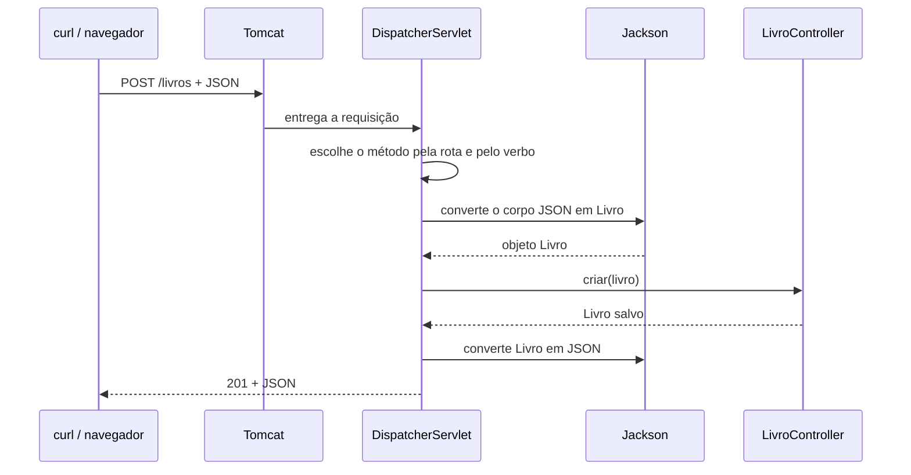
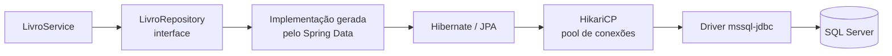

# Requisições, respostas, acesso ao banco e injeção de dependência

Este guia aprofunda o que acontece **dentro** de um projeto da coleção: como o Spring lê a requisição HTTP, como monta a resposta, como o service conversa com o banco e como os objetos são criados e ligados entre si.

O guia [02](02-arquitetura-mvc-spring.md) apresenta as camadas. Aqui o foco é o detalhe de cada passagem. Os exemplos usam o projeto `001-biblioteca` (entidades `Autor` e `Livro`), e as respostas mostradas foram capturadas com ele rodando no Tomcat.

## 1. Requisições

### Do Tomcat até o seu método



1. O **Tomcat** recebe a conexão HTTP e repassa a requisição ao `DispatcherServlet`, o servlet central do Spring MVC.
2. O `DispatcherServlet` procura o método cujo `@RequestMapping` da classe + `@GetMapping`/`@PostMapping`/... do método combinam com a rota e o verbo.
3. Cada parâmetro do método é preenchido a partir de uma parte da requisição, conforme a anotação.
4. O retorno do método vira a resposta (seção 2).

### De onde vem cada parâmetro

| Anotação | Lê de | Exemplo de requisição | Parâmetro no método |
|---|---|---|---|
| `@PathVariable` | um trecho da rota | `GET /livros/7` | `@PathVariable Long id` com `@GetMapping("/{id}")` |
| `@RequestParam` | a query string | `GET /livros?autorId=1` | `@RequestParam(required = false) Long autorId` |
| `@RequestBody` | o corpo (JSON) | `POST /livros` + `{"titulo":"..."}` | `@RequestBody Livro livro` |
| `@RequestHeader` | um cabeçalho | `User-Agent: curl/8.0` | `@RequestHeader("User-Agent") String agente` |

O Spring converte o texto para o tipo do parâmetro: `"7"` vira `Long`, `"true"` vira `Boolean`, `"2026-11-03"` vira `LocalDate`. Se a conversão falhar, o seu método nem é chamado e a resposta é `400`.

### @RequestParam: obrigatório, opcional e padrão

```java
@GetMapping("/autores/busca")
public List<Autor> buscar(@RequestParam String nome) {
    return autores.findByNomeContainingIgnoreCase(nome);
}

@GetMapping("/livros/recentes")
public List<Livro> recentes(@RequestParam(defaultValue = "Brasileira") String nacionalidade) {
    return livros.buscarPorNacionalidade(nacionalidade);
}
```

- Sem opções, o parâmetro é **obrigatório**: `GET /autores/busca` sem `?nome=` responde `400` com `Required parameter 'nome' is not present.`
- `required = false` aceita a ausência e entrega `null`. É o que os projetos usam nos filtros `?autorId=`. Por isso o tipo é `Long` (wrapper), não `long`.
- `defaultValue` usa o valor indicado quando o parâmetro não vem.

O nome do parâmetro Java precisa bater com o da URL. Se forem diferentes, informe o nome: `@RequestParam("autor") Long autorId`.

### @RequestBody: como o JSON vira objeto

O **Jackson** cria a entidade com o construtor sem argumentos e chama os setters de cada campo presente no JSON:

```json
{ "titulo": "Dom Casmurro", "anoPublicacao": 1899, "autor": { "id": 1 } }
```

| Situação no JSON | Resultado no objeto |
|---|---|
| Campo ausente (`disponivel`) | Fica `null` |
| Campo que não existe na entidade (`"xyz": 1`) | É ignorado em silêncio |
| Objeto aninhado (`"autor": {"id": 1}`) | Cria um `Autor` só com o `id` preenchido |
| Data `"1990-05-10"` em `LocalDate` | Convertida (formato ISO `aaaa-mm-dd`) |
| Data `"10/05/1990"` em `LocalDate` | `400 Bad Request` |
| Data e hora `"2026-11-03T14:30:00"` em `LocalDateTime` | Convertida (o `T` separa data e hora) |
| JSON mal formado | `400 Bad Request` |

Duas consequências práticas nos projetos:

- **PUT substitui tudo.** Um `PUT /pacientes/1` com só `{"nome":"Carlos Silva"}` grava `null` em todos os outros campos. Envie o objeto completo.
- **`id` no corpo do POST.** Os controllers gerados chamam `save` direto. Se o JSON trouxer um `id` existente, o POST **sobrescreve** aquele registro; se trouxer um `id` inexistente, o Hibernate responde `500` (`Row was updated or deleted by another transaction`). Não envie `id` no POST. O guia 02 mostra a proteção `entidade.setId(null)`.

### O que o Spring responde antes de chamar o seu código

Estas respostas foram capturadas no projeto 001, com o Tomcat:

| Requisição | Status | Motivo |
|---|---|---|
| `POST /autores` sem `Content-Type: application/json` | `415 Unsupported Media Type` | O Spring não sabe ler o corpo |
| `POST /autores` com `{"nome":` | `400 Bad Request` | JSON inválido |
| `GET /autores/abc` | `400 Bad Request` | `abc` não converte para `Long` |
| `PATCH /autores/1` | `405 Method Not Allowed` | Nenhum método aceita `PATCH`; o cabeçalho `Allow: GET, PUT, DELETE` lista os aceitos |
| `GET /naoexiste` | `404 Not Found` | Nenhuma rota combina |

## 2. Respostas

### Três formas de devolver

```java
@GetMapping
public List<Livro> listar() {
    return repository.findAll();
}

@PostMapping
@ResponseStatus(HttpStatus.CREATED)
public Livro criar(@RequestBody Livro livro) {
    return repository.save(livro);
}

@GetMapping("/{id}")
public ResponseEntity<Livro> buscar(@PathVariable Long id) {
    return repository.findById(id)
            .map(ResponseEntity::ok)
            .orElse(ResponseEntity.notFound().build());
}
```

| Forma | Status | Use quando |
|---|---|---|
| Devolver o objeto | sempre `200` | o status nunca muda (listar) |
| Objeto + `@ResponseStatus` | sempre o indicado | o status é fixo, mas não é `200` (criar → `201`) |
| `ResponseEntity<T>` | decidido em tempo de execução | depende do resultado (`200` ou `404`) |

`ResponseEntity` também permite definir cabeçalhos. A explicação de `.map(ResponseEntity::ok).orElse(...)` está no guia [01](01-orientacao-a-objetos-java.md), seção 8.

### Atalhos do ResponseEntity

| Código | Status |
|---|---|
| `ResponseEntity.ok(corpo)` | `200 OK` com corpo |
| `ResponseEntity.status(HttpStatus.CREATED).body(corpo)` | `201 Created` |
| `ResponseEntity.created(uri).body(corpo)` | `201 Created` + cabeçalho `Location` |
| `ResponseEntity.noContent().build()` | `204 No Content`, sem corpo |
| `ResponseEntity.badRequest().build()` | `400 Bad Request` |
| `ResponseEntity.notFound().build()` | `404 Not Found`, sem corpo |
| `ResponseEntity.status(HttpStatus.CONFLICT).build()` | `409 Conflict` |

O cabeçalho `Location` informa onde o recurso criado pode ser lido. O Spring injeta um `UriComponentsBuilder` já apontando para o servidor atual:

```java
@PostMapping("/autores/com-location")
public ResponseEntity<Autor> criar(@RequestBody Autor autor, UriComponentsBuilder uri) {
    autor.setId(null);
    Autor salvo = autores.save(autor);
    URI local = uri.path("/autores/{id}").buildAndExpand(salvo.getId()).toUri();
    return ResponseEntity.created(local).body(salvo);
}
```

```
HTTP/1.1 201
Location: http://localhost:9094/autores/1

{"id":1,"nome":"Machado de Assis","nacionalidade":"Brasileira"}
```

### Como o objeto vira JSON

O Jackson chama os **getters** e usa o nome de cada propriedade como chave:

| Tipo Java | No JSON |
|---|---|
| `String` | `"texto"` |
| `Integer`, `Long`, `Double` | número |
| `BigDecimal` `350.00` | `350.00` (mantém a escala) |
| `Boolean` | `true` / `false` |
| `LocalDate` | `"1990-05-10"` |
| `LocalDateTime` | `"2026-11-03T14:30:00"` |
| campo `null` | `null` (a chave continua presente) |
| relação `@ManyToOne` | objeto aninhado |
| `List<T>` | array |
| `Map<String, Object>` | objeto com as chaves do mapa |

Resposta real de `GET /consultas/1` no projeto 002 (o médico e o paciente vêm aninhados):

```json
{
  "id": 1,
  "dataHora": "2026-11-03T14:30:00",
  "valor": 350.00,
  "retorno": false,
  "medico": { "id": 1, "nome": "Dra. Ana", "crm": "123-SP", "especialidade": "Cardiologia" },
  "paciente": { "id": 1, "nome": "Carlos", "dataNascimento": "1990-05-10", "telefone": "11 99999-0000" }
}
```

Logo após o `POST`, a mesma consulta volta com `"medico": {"id": 1, "nome": null, ...}`: o objeto devolvido é o que chegou no corpo, com apenas o `id` preenchido. Um `GET` em seguida lê o registro completo do banco.

### Corpo das respostas de erro

Quando a exceção não é tratada, o Spring Boot devolve um JSON padrão:

```json
{
  "timestamp": "2026-10-20T23:22:31.579+00:00",
  "status": 500,
  "error": "Internal Server Error",
  "path": "/livros"
}
```

Por segurança, a mensagem da exceção fica de fora. Para estudar, ligue `server.error.include-message=always` (guia [05](05-configuracao-properties-sqlserver-tomcat.md)) e a resposta ganha o campo `message`:

```json
{
  "status": 400,
  "error": "Bad Request",
  "message": "Method parameter 'id': Failed to convert value of type 'java.lang.String' to required type 'java.lang.Long'; For input string: \"abc\"",
  "path": "/autores/abc"
}
```

O `404` gerado por `ResponseEntity.notFound().build()` vem **sem corpo**: é o seu código que o produz, e não um erro.

### Tratamento centralizado com @RestControllerAdvice

Nos projetos, apagar um autor que ainda tem livros ou criar um livro com `autor.id` inexistente termina em `500`, porque o SQL Server recusa a operação por causa da chave estrangeira. Uma classe com `@RestControllerAdvice` converte exceções em respostas melhores para **todos** os controllers:

```java
@RestControllerAdvice
public class TratadorDeErros {

    @ExceptionHandler(DataIntegrityViolationException.class)
    public ProblemDetail integridade(DataIntegrityViolationException e) {
        return ProblemDetail.forStatusAndDetail(
                HttpStatus.CONFLICT,
                "O registro relacionado não existe ou ainda está em uso.");
    }

    @ExceptionHandler(IllegalStateException.class)
    public ProblemDetail regraDeNegocio(IllegalStateException e) {
        return ProblemDetail.forStatusAndDetail(HttpStatus.CONFLICT, e.getMessage());
    }
}
```

`ProblemDetail` segue o padrão RFC 9457 e sai com `Content-Type: application/problem+json`. Resposta real de `DELETE /autores/1` com livros ligados:

```json
{
  "type": "about:blank",
  "title": "Conflict",
  "status": 409,
  "detail": "O registro relacionado não existe ou ainda está em uso.",
  "instance": "/autores/1"
}
```

## 3. Comunicação Service ↔ banco de dados

### As camadas até o SQL Server



- **Repository**: a interface que você declara. O Spring Data gera a implementação ao subir a aplicação.
- **Hibernate**: traduz as operações sobre entidades em SQL do dialeto do SQL Server (`TOP`, `count_big`, `datetime2`).
- **HikariCP**: mantém conexões abertas e as reaproveita. No log aparece `HikariPool-1 - Start completed.`
- **mssql-jdbc**: o driver da Microsoft, que fala o protocolo do SQL Server pela porta 1433.

### Cada método e o SQL que ele gera

Registrado no log do projeto 001 com `spring.jpa.show-sql=true`:

| Chamada no Java | SQL executado |
|---|---|
| `findAll()` | `select ... from autores a1_0` |
| `findById(id)` | `select ... from livros l1_0 left join autores a1_0 on a1_0.id=l1_0.autor_id where l1_0.id=?` |
| `existsById(id)` | `select count_big(*) from livros l1_0 where l1_0.id=?` |
| `save(livro)` com `id` `null` | `insert into livros (ano_publicacao,autor_id,disponivel,titulo) values (?,?,?,?)` |
| `save(livro)` com `id` existente | `select` do registro e depois `update livros set ... where id=?` |
| `deleteById(id)` | `select` do registro e depois `delete from livros where id=?` |
| `findByAutorId(1)` | `select ... from livros l1_0 left join autores a1_0 on a1_0.id=l1_0.autor_id where a1_0.id=?` |

Os `?` são **parâmetros**: o valor vai separado do SQL, o que impede injeção de SQL. Para ver os valores no log, use `logging.level.org.hibernate.orm.jdbc.bind=trace` (guia 05):

```
binding parameter (1:VARCHAR) <- [Brasileira]
binding parameter (2:VARCHAR) <- [Machado de Assis]
```

### Três formas de escrever consultas

**1. Pelo nome do método.** O Spring Data monta o SQL a partir do nome:

```java
public interface AutorRepository extends JpaRepository<Autor, Long> {

    List<Autor> findByNomeContainingIgnoreCase(String trecho);
}
```

SQL gerado: `... where upper(a1_0.nome) like upper(?) escape '\'`. Outras palavras aceitas: `And`, `Or`, `Between`, `LessThan`, `GreaterThanEqual`, `IsNull`, `StartingWith` e `In`. Ordenação e limite também entram no nome: `findTop3ByOrderByNomeAsc()`.

**2. JPQL com `@Query`.** Para consultas que o nome não expressa bem. JPQL usa **nomes de classes e atributos**, não de tabelas e colunas:

```java
@Query("select l from Livro l where l.autor.nacionalidade = :nacionalidade order by l.anoPublicacao desc")
List<Livro> buscarPorNacionalidade(@Param("nacionalidade") String nacionalidade);
```

**3. SQL nativo.** Usa o T-SQL do SQL Server diretamente, com nomes de tabelas e colunas:

```java
@Query(value = "SELECT TOP 5 * FROM livros ORDER BY ano_publicacao DESC", nativeQuery = true)
List<Livro> maisRecentes();
```

O SQL nativo prende o código ao SQL Server. Prefira as duas primeiras formas e use a nativa só para recursos específicos do banco.

### Transações e @Transactional

Uma **transação** agrupa operações que precisam acontecer juntas: ou todas são gravadas (`COMMIT`) ou nenhuma é (`ROLLBACK`). Cada método do repository já roda na própria transação. Quando um método do service faz **várias** operações, marque-o com `@Transactional`:

```java
@Service
public class EmprestimoService {

    private final LivroRepository repository;

    public EmprestimoService(LivroRepository repository) {
        this.repository = repository;
    }

    @Transactional
    public Optional<Livro> emprestar(Long id) {
        return repository.findById(id).map(livro -> {
            if (Boolean.FALSE.equals(livro.getDisponivel())) {
                throw new IllegalStateException("O livro " + id + " já está emprestado");
            }
            livro.setDisponivel(false);
            return livro;
        });
    }
}
```

Repare que **não há `save`**. Dentro de uma transação, a entidade carregada fica *gerenciada*: o Hibernate compara o estado dela no fim do método com o estado lido e gera o `UPDATE` sozinho (*dirty checking*). No log aparece `update livros set ano_publicacao=?,autor_id=?,disponivel=?,titulo=? where id=?`.

Regras do `@Transactional`:

- Uma `RuntimeException` lançada dentro do método provoca `ROLLBACK`. No exemplo, o segundo empréstimo do mesmo livro lança `IllegalStateException`, nada é gravado e o `@RestControllerAdvice` responde `409` com `"O livro 1 já está emprestado"`.
- Exceções *checked* **não** desfazem a transação, a menos que você indique `@Transactional(rollbackFor = Exception.class)`.
- Use em métodos públicos chamados **de fora** da classe. Um método chamando outro `@Transactional` da mesma classe ignora a anotação, porque a chamada não passa pelo proxy do Spring (seção 4).
- `@Transactional(readOnly = true)` em consultas evita a checagem de alterações e deixa clara a intenção.

### open-in-view=false e o ciclo de vida da conexão

Os projetos definem `spring.jpa.open-in-view=false`. Assim, a conexão com o banco é devolvida ao pool **ao fim de cada chamada ao repository** (ou do método `@Transactional`), e não só quando a resposta HTTP termina. Como as relações são `@ManyToOne` (carregadas junto, `EAGER`), o JSON é montado sem precisar voltar ao banco.

Se um dia você usar `@OneToMany` (carregada sob demanda, `LAZY`) e serializar a lista fora da transação, o resultado será `LazyInitializationException`. Nesse caso, carregue os dados dentro do service com `@Transactional` ou use uma consulta com `join fetch`.

## 4. Injeção de dependência

### O container e os beans

Ao subir, o Spring cria um **container** (o `ApplicationContext`) e o enche de **beans**: objetos que ele mesmo cria, guarda e entrega a quem pedir. Você declara do que uma classe precisa e o container resolve a ordem de criação:

```mermaid
flowchart LR
    A[Application<br/>@SpringBootApplication] -->|varre com.exemplo.biblioteca.*| B[Encontra @RestController,<br/>@Service, repositories]
    B --> C[Cria LivroRepository<br/>implementação gerada]
    C --> D[Cria LivroService<br/>recebendo o repository]
    D --> E[Cria LivroController<br/>recebendo o service]
```

| Como vira bean | Exemplo | Quem cria |
|---|---|---|
| `@RestController` / `@Controller` | `LivroController` | varredura de componentes |
| `@Service` | `LivroService` | varredura de componentes |
| `@Component` | qualquer classe auxiliar | varredura de componentes |
| Interface que estende `JpaRepository` | `LivroRepository` | Spring Data JPA |
| Método `@Bean` em classe `@Configuration` | um `Clock` | você, no método |
| Configuração automática | `DataSource`, `EntityManager`, `ObjectMapper` | Spring Boot, a partir das dependências e do `application.properties` |

A varredura começa no pacote da classe `Application` (`com.exemplo.biblioteca`) e desce para os subpacotes. Uma classe anotada fora dessa árvore não vira bean, e quem depende dela falha com `NoSuchBeanDefinitionException`.

### Formas de injetar

```java
@RestController
public class LivroController {

    private final LivroRepository repository;

    public LivroController(LivroRepository repository) {
        this.repository = repository;
    }
}
```

Os projetos usam **injeção por construtor**: o campo é `final`, a classe não funciona sem a dependência, e um teste pode criar o objeto com `new LivroController(repositorioFalso)`. Com um único construtor, o `@Autowired` é dispensável.

Com Lombok, `@RequiredArgsConstructor` gera esse construtor para todos os campos `final`:

```java
@RestController
@RequiredArgsConstructor
public class LivroController {

    private final LivroRepository repository;
}
```

A injeção por campo (`@Autowired private LivroRepository repository;`) também funciona, mas esconde as dependências e impede o `final`. O guia 02 compara as duas formas.

### Injetando valores e criando beans próprios

`@Value` injeta uma propriedade do `application.properties`:

```java
public ExemplosController(
        AutorRepository autores,
        Clock relogio,
        @Value("${spring.application.name}") String nomeAplicacao) {
    this.autores = autores;
    this.relogio = relogio;
    this.nomeAplicacao = nomeAplicacao;
}
```

Para um objeto de uma classe que não é sua (e que você não pode anotar), declare um método `@Bean`:

```java
@Configuration
public class Configuracao {

    @Bean
    public Clock relogio() {
        return Clock.systemDefaultZone();
    }
}
```

O retorno vira um bean e pode ser injetado em qualquer construtor. Um endpoint que usa os dois respondeu:

```json
{ "aplicacao": "biblioteca", "agora": "2026-10-20T20:46:52.953948", "agente": "curl-doc" }
```

### Escopo e estado

Por padrão, cada bean é **singleton**: existe um só `LivroController` atendendo todas as requisições ao mesmo tempo, em threads diferentes. Por isso:

- Guarde em campos só dependências (`final`) e configurações.
- Nunca guarde dados de uma requisição em um campo do controller ou do service: outra requisição simultânea veria ou sobrescreveria o valor.
- Use variáveis locais e parâmetros para os dados de cada chamada.

### O proxy por trás das anotações

Quando um bean tem `@Transactional`, o Spring entrega aos outros beans um **proxy**: um objeto que envolve o original, abre a transação, chama o método real e faz `COMMIT` ou `ROLLBACK`. É por isso que uma chamada interna (`this.outroMetodo()`) não passa pela transação: ela vai direto ao objeto, sem atravessar o proxy. Os repositories também são proxies; é assim que uma interface sem implementação consegue executar SQL.

### Erros comuns de injeção

| Erro no log | Causa | Correção |
|---|---|---|
| `NoSuchBeanDefinitionException: No qualifying bean of type '...LivroService'` | A classe não tem `@Service`, ou está fora do pacote de `Application` | Adicione a anotação; mova a classe para baixo de `com.exemplo.<slug>` |
| `UnsatisfiedDependencyException` | Uma dependência da dependência falhou | Leia o último `Caused by:` |
| `The dependencies of some of the beans in the application context form a cycle` | A precisa de B e B precisa de A | Extraia a parte comum para um terceiro bean |
| `NoUniqueBeanDefinitionException: expected single matching bean but found 2` | Dois beans do mesmo tipo | Marque um com `@Primary` ou escolha com `@Qualifier("nome")` |
| `Could not resolve placeholder 'x' in value "${x}"` | `@Value` aponta para uma propriedade inexistente | Crie a propriedade ou use um padrão: `@Value("${x:padrao}")` |
