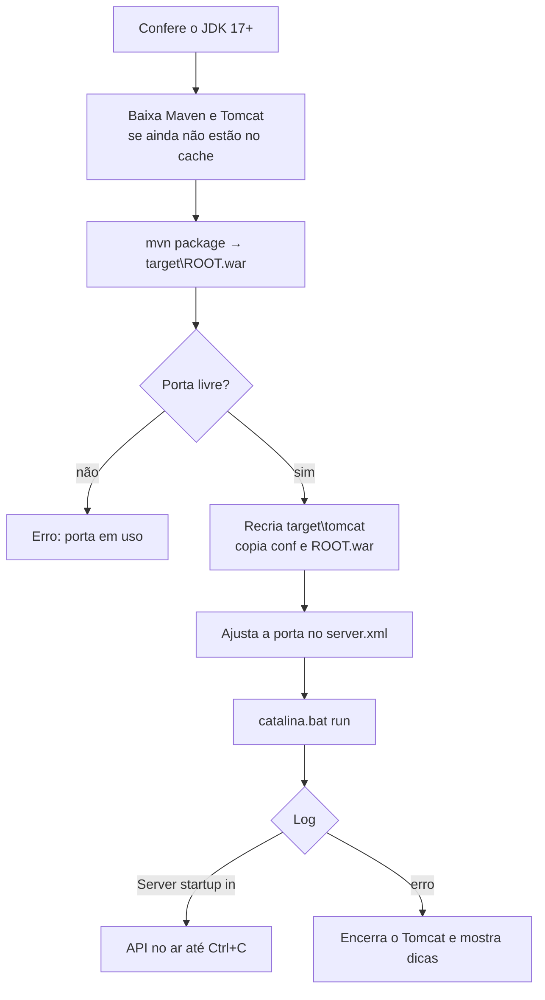

# Configuração: application.properties, SQL Server, H2 e Tomcat

Este guia explica onde fica cada configuração dos projetos, como alterá-la sem editar código e como o banco e o servidor são preparados. Os valores mostrados são os padrões da coleção: banco `projeto`, login `projeto`, senha `Projeto@123`, SQL Server na porta 1433 e Tomcat 10.1.61 na porta 8080. Os projetos 101 em diante usam H2 em vez de SQL Server (seção 3).

## 1. application.properties

### Onde fica e como é lido

O arquivo fica em `src/main/resources/application.properties`. No empacotamento, o Maven o copia para `WEB-INF/classes/application.properties`, dentro do `ROOT.war`, e o Spring Boot o lê ao subir.

Regras do formato:

- Uma propriedade por linha, no formato `chave=valor`, sem aspas.
- Linhas iniciadas por `#` são comentários.
- A barra invertida `\` é caractere de escape. Para escrever uma barra literal, use `\\` (exemplo na seção 2).
- Espaços em volta do `=` são ignorados; espaços no fim do valor, não.

Depois de editar, rode `run.ps1` de novo: ele recompila, gera um novo WAR e reinicia o Tomcat.

### As propriedades dos projetos

```properties
spring.application.name=biblioteca

spring.datasource.url=jdbc:sqlserver://localhost:1433;databaseName=projeto;encrypt=true;trustServerCertificate=true
spring.datasource.username=projeto
spring.datasource.password=Projeto@123

spring.jpa.hibernate.ddl-auto=update
spring.jpa.show-sql=true
spring.jpa.open-in-view=false
```

| Propriedade | Efeito |
|---|---|
| `spring.application.name` | Nome da aplicação. Aparece em cada linha do log (`[biblioteca]`) e pode ser lido com `@Value`. |
| `spring.datasource.url` | Endereço JDBC do banco: SQL Server (seção 2) ou H2 (seção 3). |
| `spring.datasource.username` / `password` | Login SQL usado na conexão. |
| `spring.jpa.hibernate.ddl-auto=update` | O Hibernate cria tabelas, colunas e chaves estrangeiras que faltam. Nunca apaga nem altera colunas existentes. |
| `spring.jpa.show-sql=true` | Imprime cada SQL no console, com o prefixo `Hibernate:`. |
| `spring.jpa.open-in-view=false` | A conexão volta ao pool logo após cada operação no banco (guia [04](04-requisicoes-respostas-e-injecao.md), seção 3). |

O driver do SQL Server, o dialeto do Hibernate e o pool de conexões são detectados automaticamente a partir da URL e das dependências do `pom.xml`.

Valores de `ddl-auto`:

| Valor | Ao subir | Uso |
|---|---|---|
| `none` | Não mexe no banco | Produção com migrações (Flyway, Liquibase) |
| `validate` | Confere se tabelas e colunas batem com as entidades; falha se não baterem | Produção |
| `update` | Cria o que falta | Estudo (padrão dos projetos) |
| `create` | Apaga e recria as tabelas das entidades | Testes; **perde dados** |
| `create-drop` | Como `create`, e apaga tudo ao desligar | Testes automatizados |

### Propriedades úteis para estudar

Todas foram testadas nos projetos rodando no Tomcat:

```properties
# SQL formatado em várias linhas
spring.jpa.properties.hibernate.format_sql=true

# SQL pelo sistema de log (com data e hora) e valores dos parâmetros "?"
# (troque show-sql=true por estas duas linhas para não duplicar o SQL)
logging.level.org.hibernate.SQL=debug
logging.level.org.hibernate.orm.jdbc.bind=trace

# Inclui a mensagem da exceção no JSON de erro
server.error.include-message=always

# JSON da resposta indentado
spring.jackson.serialization.indent-output=true
```

Saída com `format_sql=true`:

```
Hibernate: 
    select
        a1_0.id,
        a1_0.nacionalidade,
        a1_0.nome 
    from
        autores a1_0
```

Saída com `orm.jdbc.bind=trace` em um `INSERT`:

```
binding parameter (1:VARCHAR) <- [Brasileira]
binding parameter (2:VARCHAR) <- [Machado de Assis]
```

`server.error.include-message=always` mostra detalhes internos do erro. Use só em desenvolvimento.

### Propriedades que não valem no Tomcat externo

`server.port`, `server.servlet.context-path` e as demais `server.*` ligadas ao servidor configuram o **Tomcat embutido**. Como os projetos rodam em um Tomcat externo, elas são ignoradas: subir o projeto 001 com `server.port=7777` e `server.servlet.context-path=/api` manteve a API em `http://localhost:8080/autores`. A porta é definida pelo `run.ps1 -Porta` e o caminho pelo nome do WAR (seção 4). `server.error.*` continua valendo, porque é tratada pelo Spring, e não pelo servidor.

### Mudando valores sem editar o arquivo

O Spring Boot aceita a mesma propriedade de várias fontes. Quando uma chave aparece em mais de uma, vale a de maior prioridade:

| Prioridade | Fonte | Exemplo |
|---|---|---|
| 1 (maior) | Propriedade de sistema Java (`-D`) | `-Dspring.jpa.show-sql=false` em `CATALINA_OPTS` |
| 2 | Variável de ambiente | `SPRING_JPA_SHOW_SQL=false` |
| 3 | `application-<perfil>.properties` do perfil ativo | `application-dev.properties` |
| 4 (menor) | `application.properties` | o arquivo dos projetos |

Para converter uma propriedade em variável de ambiente: letras maiúsculas, `.` vira `_` e `-` é removido. `spring.jpa.show-sql` vira `SPRING_JPA_SHOW_SQL`; `spring.datasource.password` vira `SPRING_DATASOURCE_PASSWORD`.

No PowerShell, a variável vale para a janela atual e é herdada pelo Tomcat que o `run.ps1` inicia:

```powershell
$env:SPRING_DATASOURCE_PASSWORD = "OutraSenha@1"
.\run.ps1
```

No `cmd`, use `set SPRING_DATASOURCE_PASSWORD=OutraSenha@1` antes de `run.bat`. Para propriedades Java, use `CATALINA_OPTS`:

```powershell
$env:CATALINA_OPTS = "-Dserver.error.include-message=always -Dspring.jpa.properties.hibernate.format_sql=true"
.\run.ps1
```

O `run.ps1` define `JAVA_OPTS` para forçar UTF-8 no console, sobrescrevendo qualquer valor anterior. Use sempre `CATALINA_OPTS` para as suas opções.

Variáveis definidas com `$env:` continuam valendo até você fechar a janela. Para removê-las: `Remove-Item Env:SPRING_DATASOURCE_PASSWORD`.

Variáveis de ambiente são a forma usual de passar senhas reais sem gravá-las em um arquivo que vai para o Git.

### Perfis

Um **perfil** é um conjunto de propriedades ativado por nome. Crie `src/main/resources/application-dev.properties` só com o que muda:

```properties
spring.jpa.show-sql=false
logging.level.org.hibernate.SQL=debug
logging.level.org.hibernate.orm.jdbc.bind=trace
server.error.include-message=always
```

E ative o perfil antes de rodar:

```powershell
$env:SPRING_PROFILES_ACTIVE = "dev"
.\run.ps1
```

O log confirma: `The following 1 profile is active: "dev"`. As propriedades do perfil sobrescrevem as do `application.properties`; as demais continuam valendo. Vários perfis podem ser ativados de uma vez, separados por vírgula.

Para ler uma propriedade dentro do código Java, use `@Value("${chave}")` (guia [04](04-requisicoes-respostas-e-injecao.md), seção 4).

## 2. Configuração do SQL Server

### O que o setup-sqlserver.ps1 faz

Rode na raiz do repositório, em um PowerShell **como Administrador**:

```powershell
.\setup-sqlserver.ps1
```

| Passo | O que muda | Como fazer à mão |
|---|---|---|
| 1. TCP/IP | Liga o protocolo TCP/IP da instância, com porta fixa 1433 em todas as interfaces | **SQL Server Configuration Manager** → **SQL Server Network Configuration** → **Protocols for SQLEXPRESS** → **TCP/IP** = Enabled → aba **IP Addresses** → em **IPAll**, **TCP Dynamic Ports** vazio e **TCP Port** = `1433` |
| 2. Autenticação mista | Aceita logins SQL, além dos usuários do Windows | SSMS → botão direito no servidor → **Properties** → **Security** → **SQL Server and Windows Authentication mode** |
| 3. Reinício | Reinicia o serviço e o deixa com início automático | `services.msc` → **SQL Server (SQLEXPRESS)** → Reiniciar |
| 4. Login | Cria ou redefine o login `projeto` | `CREATE LOGIN projeto WITH PASSWORD = 'Projeto@123', CHECK_POLICY = OFF;` |
| 5. Banco | Apaga o banco `projeto`, se existir, cria um vazio e torna o login seu dono | `CREATE DATABASE projeto;` e `ALTER AUTHORIZATION ON DATABASE::projeto TO projeto;` |
| 6. Firewall | Libera a porta 1433 nos perfis Privado e Domínio | **Windows Defender Firewall** → Regras de Entrada |

Ao terminar, o script testa a conexão com o login novo e imprime o passo a passo.

Os passos 1 e 2 só valem depois do reinício do serviço. Esse é o motivo mais comum de "liguei o TCP e continua sem conectar".

Todos os valores podem ser trocados por parâmetros:

```powershell
.\setup-sqlserver.ps1 -Instancia SQLEXPRESS -Banco projeto -Usuario projeto -Senha 'Projeto@123' -Porta 1433
```

Para a instância padrão (não Express), use `-Instancia MSSQLSERVER`. Se mudar banco, login, senha ou porta, ajuste o `application.properties` (ou use variáveis de ambiente) em cada projeto.

### Anatomia da URL JDBC

```
jdbc:sqlserver://localhost:1433;databaseName=projeto;encrypt=true;trustServerCertificate=true
```

| Parte | Significado |
|---|---|
| `jdbc:sqlserver://` | Usa o driver `mssql-jdbc` da Microsoft |
| `localhost` | Máquina do SQL Server |
| `:1433` | Porta TCP. Fixada pelo setup |
| `databaseName=projeto` | Banco usado. Precisa existir; o Hibernate cria só as tabelas |
| `encrypt=true` | Conexão criptografada (padrão do driver atual) |
| `trustServerCertificate=true` | Aceita o certificado autoassinado do SQL Server local. Em produção, use um certificado válido e remova esta opção |

Variações comuns:

```properties
# Outro banco ou outra porta
spring.datasource.url=jdbc:sqlserver://localhost:1434;databaseName=estudos;encrypt=true;trustServerCertificate=true

# Outra máquina da rede
spring.datasource.url=jdbc:sqlserver://192.168.0.20:1433;databaseName=projeto;encrypt=true;trustServerCertificate=true

# Pelo nome da instância, sem porta: exige o serviço SQL Server Browser em execução
# e a barra invertida dobrada, porque "\" é escape no .properties
spring.datasource.url=jdbc:sqlserver://localhost\\SQLEXPRESS;databaseName=projeto;encrypt=true;trustServerCertificate=true
```

Com porta fixa, o SQL Server Browser não é necessário. Por isso os projetos usam `localhost:1433`.

### Pool de conexões

O Spring Boot usa o **HikariCP**, que mantém conexões abertas e as reaproveita. Os padrões servem para estudo; os ajustes mais comuns são:

```properties
spring.datasource.hikari.maximum-pool-size=10
spring.datasource.hikari.connection-timeout=30000
```

`maximum-pool-size` limita as conexões simultâneas; `connection-timeout` é quanto tempo, em milissegundos, uma requisição espera por uma conexão livre antes de falhar.

### Como as entidades viram tabelas

Com `ddl-auto=update`, o log do projeto 002 mostra:

```sql
create table medicos (id bigint identity not null, crm varchar(255), especialidade varchar(255), nome varchar(255), primary key (id))
create table consultas (id bigint identity not null, data_hora datetime2(6), retorno bit, valor numeric(38,2), medico_id bigint, paciente_id bigint, primary key (id))
alter table consultas add constraint FK9ufe3uh84ex5uofhsubaan07m foreign key (medico_id) references medicos
```

- O nome da tabela vem de `@Table(name = "...")`.
- Atributos em *camelCase* viram colunas em *snake_case*: `dataHora` → `data_hora`, `anoPublicacao` → `ano_publicacao`.
- `@JoinColumn(name = "medico_id")` define a coluna da chave estrangeira.
- O mapeamento completo de tipos Java → SQL Server está no guia [03](03-sql-server-guia-rapido.md), seção 3.

**Por que rodar o setup de novo ao trocar de projeto.** Vários projetos usam tabelas com o mesmo nome (`clientes`, `produtos`) e colunas diferentes. O `update` não remove nem altera colunas existentes; as sobras do projeto anterior causam erros de chave estrangeira ou de coluna obrigatória. O setup recria o banco vazio.

### Checklist de conexão

1. O serviço está rodando? `sc query "MSSQL$SQLEXPRESS"` deve mostrar `RUNNING`.
2. A porta está aberta? `netstat -an | findstr 1433` deve mostrar `LISTENING`.
3. O login funciona fora do Java? `sqlcmd -S localhost,1433 -d projeto -U projeto -P Projeto@123 -C`.
4. Se o `sqlcmd` conecta e a aplicação não, o problema está na URL, no usuário ou na senha do `application.properties`, ou em uma variável de ambiente que os sobrescreve.

As mensagens de erro mais comuns e suas correções estão no guia [03](03-sql-server-guia-rapido.md), seção 11. O `run.ps1` também reconhece essas mensagens e imprime dicas.

## 3. Configuração do H2

O **H2** é um banco SQL escrito em Java que roda **dentro** da aplicação: não há serviço, instalação, login nem porta. Ele vem como dependência do Maven, no lugar do driver do SQL Server:

```xml
<dependency>
    <groupId>com.h2database</groupId>
    <artifactId>h2</artifactId>
    <scope>runtime</scope>
</dependency>
```

O `application.properties` dos projetos H2 (exemplo do 101):

```properties
spring.datasource.url=jdbc:h2:file:./data/joalheria
spring.datasource.username=sa
spring.datasource.password=

spring.h2.console.enabled=true
```

As propriedades `spring.jpa.*` são as mesmas dos projetos SQL Server; entidades, repositórios e controllers não mudam. O Hibernate detecta o dialeto pela URL.

### Onde ficam os dados

| URL | Onde ficam os dados | Ao reiniciar |
|---|---|---|
| `jdbc:h2:file:./data/joalheria` (padrão dos projetos) | Arquivo `data\joalheria.mv.db` | Os dados continuam |
| `jdbc:h2:mem:joalheria` | Memória do processo | Tudo some |

`./data` é relativo à pasta de onde o Tomcat é iniciado. O `run.ps1` inicia o Tomcat na pasta do projeto, então o arquivo fica em `data\` ao lado do `pom.xml`. A pasta está no `.gitignore`. Para zerar o banco, pare o projeto e apague `data`.

Como cada projeto tem o próprio arquivo, **não é preciso** rodar o `setup-sqlserver.ps1` ao trocar de projeto.

### Console web

Com `spring.h2.console.enabled=true`, o H2 oferece uma tela para executar SQL em http://localhost:8080/h2-console. Preencha:

- **JDBC URL:** a mesma do `application.properties` (`jdbc:h2:file:./data/joalheria`);
- **User Name:** `sa`;
- **Password:** vazio.

O console usa a conexão da própria aplicação, então funciona com o projeto rodando. Ele dá acesso total ao banco: deixe-o desligado fora do ambiente de estudo.

### Um arquivo, um processo

No modo `file`, o H2 trava o arquivo enquanto ele está aberto. Se outro processo já o usa (o mesmo projeto rodando em outra janela, ou um cliente SQL externo), a aplicação não sobe e o log mostra `Database may be already in use`. O `run.ps1` reconhece essa mensagem e avisa. Feche o outro processo e rode de novo.

### Diferenças em relação ao SQL Server

| | SQL Server | H2 |
|---|---|---|
| Instalação | Serviço do Windows + `setup-sqlserver.ps1` | Nenhuma (dependência Maven) |
| Onde ficam os dados | Banco `projeto`, compartilhado | `data\<slug>.mv.db`, um por projeto |
| `id` gerado | `bigint identity` | `bigint generated by default as identity` |
| `Double` | `float` | `float(53)` |
| Limitar linhas | `SELECT TOP 5 ...` | `SELECT ... FETCH FIRST 5 ROWS ONLY` (padrão SQL); `LIMIT 5` e `TOP 5` também são aceitos |
| Violação de chave estrangeira | `The DELETE statement conflicted with the REFERENCE constraint` | `Referential integrity constraint violation` |
| Palavras reservadas | `user`, `order`, `key`... | Também `value`, `limit`, `minute`, `row`, `year`... |

Código que usa só o repositório e JPQL funciona igual nos dois bancos. Consultas `nativeQuery` são SQL do banco e podem precisar de ajuste: o H2 aceita boa parte do T-SQL simples (como `TOP`), mas não funções específicas do SQL Server.

O gerador recusa nomes de tabela e coluna reservados no H2 (lista `$ReservadasH2` em `gerador/gerar.ps1`). Isso inclui a forma em *snake_case*: um campo `dataHora` vira a coluna `data_hora`.

## 4. Configuração do Tomcat

### Tomcat embutido x Tomcat externo

Um projeto Spring Boot pode rodar de duas formas:

- **Embutido (JAR):** o Tomcat vai dentro do arquivo e sobe com `java -jar app.jar`. É o padrão do Spring Boot.
- **Externo (WAR):** o projeto vira um `.war`, implantado em um Tomcat instalado à parte, que pode hospedar várias aplicações. É o modelo usado nesta coleção.

Quatro peças do projeto tornam o deploy em Tomcat externo possível:

```xml
<packaging>war</packaging>

<dependency>
    <groupId>org.springframework.boot</groupId>
    <artifactId>spring-boot-starter-tomcat</artifactId>
    <scope>provided</scope>
</dependency>

<build>
    <finalName>ROOT</finalName>
</build>
```

- `<packaging>war</packaging>`: o Maven gera `target/ROOT.war` em vez de um JAR.
- `<scope>provided</scope>`: o Tomcat já existe no servidor, então as classes dele não vão para `WEB-INF/lib`. Ficam em `WEB-INF/lib-provided`, usadas apenas quando o WAR é executado sozinho.
- `<finalName>ROOT</finalName>`: o nome do arquivo define o caminho da aplicação (mais abaixo).
- `Application extends SpringBootServletInitializer`: o ponto de entrada para o Tomcat. No Tomcat externo o `main` não é chamado; o Tomcat encontra essa classe ao implantar o WAR e chama `configure`:

```java
@SpringBootApplication
public class Application extends SpringBootServletInitializer {

    @Override
    protected SpringApplicationBuilder configure(SpringApplicationBuilder builder) {
        return builder.sources(Application.class);
    }

    public static void main(String[] args) {
        SpringApplication.run(Application.class, args);
    }
}
```

O `main` continua lá: `java -jar target\ROOT.war --server.port=9093` também sobe a aplicação, com o Tomcat embutido de `WEB-INF/lib-provided`. Nesse modo as propriedades `server.*` voltam a valer.

**Versão do Tomcat.** Spring Boot 3 usa os pacotes `jakarta.*` (Jakarta EE 10, Servlet 6). Ele precisa do **Tomcat 10.1** ou mais novo. O Tomcat 9 usa `javax.*` e não consegue carregar a aplicação.

### O que o run.ps1 faz



Uso:

```powershell
.\run.ps1                 # compila, implanta e sobe na porta 8080
.\run.ps1 -Porta 9090     # outra porta
.\run.ps1 -SoCompilar     # só gera target\ROOT.war
.\run.ps1 -Limpar         # apaga target antes de compilar
```

O `run.bat` repassa os mesmos parâmetros: `run.bat -Porta 9090`.

### CATALINA_HOME e CATALINA_BASE

O Tomcat separa os **binários** da **instância**:

| Variável | Aponta para | Conteúdo |
|---|---|---|
| `CATALINA_HOME` | `%LOCALAPPDATA%\spring-crud-exemplos\apache-tomcat-10.1.61` | `bin` e `lib`: o Tomcat em si, baixado uma vez e compartilhado |
| `CATALINA_BASE` | `target\tomcat` do projeto | `conf`, `webapps`, `logs`, `temp` e `work`: só deste projeto |

```
target\tomcat\
  conf\server.xml      porta HTTP e porta de desligamento
  conf\web.xml         configuração padrão dos servlets
  webapps\ROOT.war     o projeto
  webapps\ROOT\        o WAR extraído pelo Tomcat
  logs\                logs desta execução
  temp\  work\         arquivos temporários
```

Com uma base por projeto, nenhum projeto vê o WAR de outro, e as aplicações de exemplo do Tomcat (`manager`, `examples`, `docs`) não são implantadas. A pasta é recriada a cada execução: edições manuais em `target\tomcat\conf` se perdem.

### server.xml: porta e desligamento

Trecho relevante de `conf\server.xml` depois do ajuste do `run.ps1`:

```xml
<Server port="-1" shutdown="SHUTDOWN">
  ...
  <Connector port="8080" protocol="HTTP/1.1"
             connectionTimeout="20000"
             redirectPort="8443"
             maxParameterCount="1000"
             />
```

- `Connector port`: a porta HTTP. O `run.ps1` troca o `8080` pelo valor de `-Porta`.
- `Server port="-1"`: desliga a porta de desligamento (8005 no original). Assim dois projetos podem rodar ao mesmo tempo em portas HTTP diferentes, e o Tomcat é encerrado pelo `Ctrl+C`.
- `connectionTimeout`: milissegundos de espera pela requisição depois que a conexão abre.

### Caminho da aplicação (context path)

O Tomcat usa o **nome do WAR** como prefixo das rotas:

| Arquivo em `webapps` | URL da rota `/autores` |
|---|---|
| `ROOT.war` | `http://localhost:8080/autores` |
| `biblioteca.war` | `http://localhost:8080/biblioteca/autores` |

Testado com o projeto 001: com o arquivo renomeado para `biblioteca.war`, `/biblioteca/autores` respondeu `200` e `/autores`, `404`. O nome `ROOT` é especial: implanta a aplicação na raiz.

### Opções da JVM e setenv.bat

`CATALINA_OPTS` repassa opções para a JVM do Tomcat. Exemplos:

```powershell
# Memória máxima de 512 MB e uma propriedade do Spring
$env:CATALINA_OPTS = "-Xmx512m -Dserver.error.include-message=always"
.\run.ps1
```

O Tomcat imprime o valor recebido no início do log: `Using CATALINA_OPTS: "-Xmx512m ..."`.

Em um Tomcat instalado de forma permanente, a configuração fixa fica em `bin\setenv.bat` (da `CATALINA_BASE`), que o `catalina.bat` executa ao iniciar:

```bat
set "CATALINA_OPTS=%CATALINA_OPTS% -Xmx512m -Dserver.error.include-message=always"
```

Como o `run.ps1` recria `target\tomcat`, use `CATALINA_OPTS` em vez de `setenv.bat` nos projetos da coleção.

### Logs

| Arquivo em `target\tomcat\logs` | Conteúdo |
|---|---|
| `console.log` | Tudo o que aparece no terminal: Tomcat, Spring e SQL. Fonte principal para depurar |
| `catalina.<data>.log` | Mensagens do próprio Tomcat (início, implantação, desligamento) |
| `localhost.<data>.log` | Mensagens do contêiner de servlets, incluindo falhas ao iniciar a aplicação |
| `localhost_access_log.<data>.txt` | Uma linha por requisição: IP, data, método, rota, status e bytes |

Exemplo do log de acesso:

```
0:0:0:0:0:0:0:1 - - [20/Oct/2026:20:22:31 -0300] "POST /livros HTTP/1.1" 500 144
0:0:0:0:0:0:0:1 - - [20/Oct/2026:20:22:31 -0300] "GET /naoexiste HTTP/1.1" 404 135
```

O `run.ps1` detecta o fim da subida pela linha `Server startup in [...] milliseconds` e uma falha por linhas como `Application run failed`. Em caso de erro, procure o último `Caused by:` no `console.log`.

### Implantar em outro Tomcat

Para usar um Tomcat 10.1 que você já tem instalado (por exemplo, em `C:\tomcat`):

```powershell
.\run.ps1 -SoCompilar
Copy-Item target\ROOT.war C:\tomcat\webapps\biblioteca.war
& C:\tomcat\bin\catalina.bat run
```

A API fica em `http://localhost:8080/biblioteca/...`. Use outro nome de WAR para cada projeto. Se a pasta `webapps` já tiver um `ROOT`, não sobrescreva: ele é a página inicial do Tomcat.

O `catalina.bat` precisa de `JAVA_HOME` (ou `JRE_HOME`) apontando para um JDK 17+. `catalina.bat run` mantém o Tomcat no terminal até `Ctrl+C`; `bin\startup.bat` o abre em outra janela, e `bin\shutdown.bat` o encerra pela porta 8005 do `server.xml` original.

### Problemas comuns

| Sintoma | Causa | Correção |
|---|---|---|
| `A porta 8080 já está em uso` | Outro projeto (ou outro programa) ocupa a porta | Feche a outra janela ou use `.\run.ps1 -Porta 9090` |
| Porta continua ocupada depois de fechar a janela | O Tomcat ficou vivo sem `Ctrl+C` | `Get-NetTCPConnection -LocalPort 8080 -State Listen` mostra o PID; encerre com `taskkill /T /F /PID <pid>` |
| `404` em todas as rotas | WAR com outro nome (prefixo no caminho) ou aplicação que falhou ao subir | Confira o nome em `webapps` e procure `Caused by:` no `console.log` |
| WAR implantado, mas o Spring não inicia (sem o banner) e tudo responde `404` | Tomcat 9 ou anterior, que procura `javax.servlet` e não enxerga a aplicação `jakarta.servlet` | Use Tomcat 10.1+ |
| `UnsupportedClassVersionError` | Tomcat rodando com Java mais antigo que o usado na compilação | Aponte `JAVA_HOME` para um JDK 17+ |
| Mudança no `application.properties` não teve efeito | O WAR antigo continua implantado, ou uma variável de ambiente sobrescreve o valor | Rode `run.ps1` de novo; confira `Get-ChildItem Env:SPRING*` |
| Download do Tomcat falha | Sem internet ou com proxy | Baixe `apache-tomcat-10.1.61-windows-x64.zip` e extraia em `%LOCALAPPDATA%\spring-crud-exemplos` |
